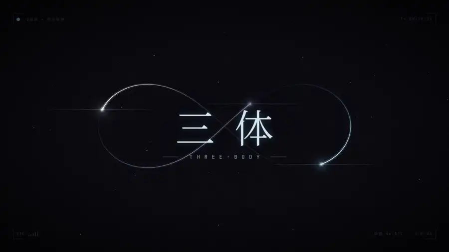
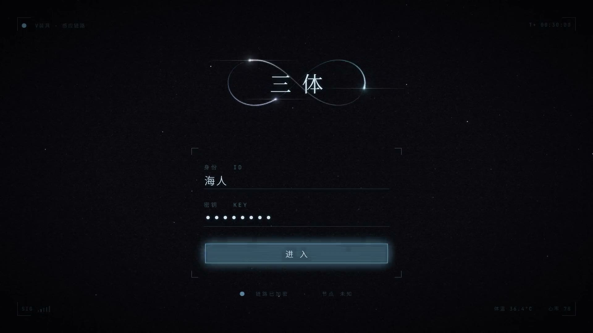
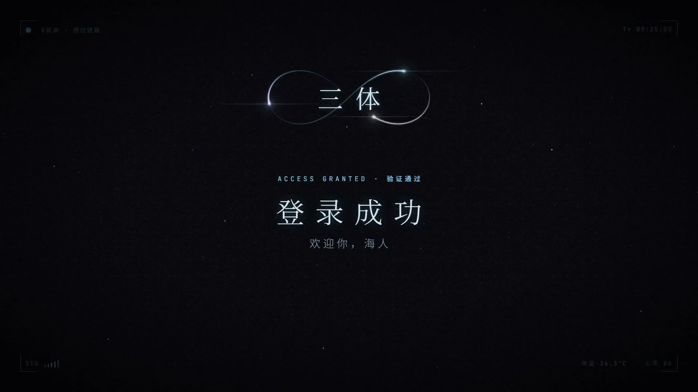
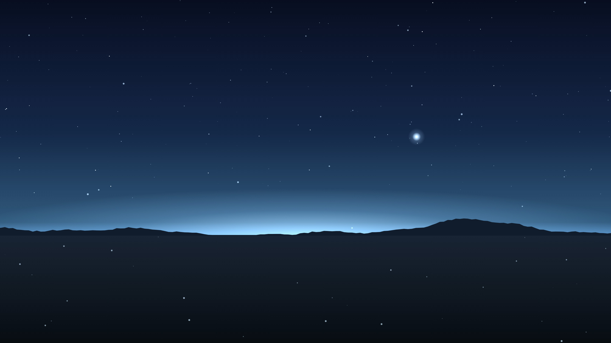

# 三体 · 启动片头 for DeepSeek Harness

[](LICENSE)
[](https://github.com/chenbocheng2568-dot/dsh-threebody-boot)
[](#为什么只有-27-mb)

打开 DeepSeek Harness 时，先放一段《三体》游戏的启动界面：三颗星沿 8 字轨道彼此追逐，「三体」标题从模糊里浮现，接着是登录页——身份栏写着你的 ID，点「进入」后扫描验证，穿过轨道中心落到荒原上，再淡入 DSH。

片头是**实时渲染**的，不是视频：插件直接跑片子自己的 React 组件，用一个可暂停的 30 fps 时钟替代 Remotion 渲染器，所以画面与导出的成片逐帧一致（实测同一帧平均像素差 < 1，只有颗粒噪点不同）。




## 它做什么

| | |
|---|---|
| **开场** | 电影感片头，两档节奏：精简（约 31 秒）从标题直接进登录；完整（约 48 秒）多出唤醒与自检、穿过轨道的推镜、「纪元 · 未知」 |
| **登录闸** | 登录页会**停下来等你用鼠标点「进入」**，键盘和点在别处都不会继续。等待时星星在转、HUD 计时在走、底噪在播 |
| **身份** | 身份栏显示你在设置里填的 ID（默认「海人」），最多 12 字；密钥自动填满 8 位 |
| **收尾** | 验证通过后显示「登录成功 · 欢迎你，××」，停在群山远景；装了同套件的皮肤时，远景用 2.8 秒淡成界面上的虚影 |
| **可关闭** | 设成「关闭」就完全跳过，不留黑帧、不拖慢启动 |

### 为什么只有 2.7 MB

| 做法 | 体积 |
|---|---|
| 0.1.x：把渲染好的视频塞进插件 | 约 19 MB |
| 0.3.x：只带代码与音轨，画面实时画出来 | 约 2.7 MB |

音轨是 AAC 192k（1.1 MB）、登录等待的循环底噪是 10 秒 24 kHz WAV（0.94 MB），其余是打包后的播放器（299 KB）和中文字体子集（382 KB）。

## 安装

从 GitHub：

```bash
dsh plugin --profile desktop add github:chenbocheng2568-dot/dsh-threebody-boot
```

从 npm（已发布后）：

```bash
dsh plugin --profile desktop add dsh-threebody-boot
```

装完重启 DSH。profile 名要跟你实际用的一致：桌面客户端是 `desktop`，dsh web 是 `web`。更新时先 remove 再 add。

搭配 [dsh-threebody-skin](https://github.com/chenbocheng2568-dot/dsh-threebody-skin) 才是完整体验：片尾远景直接淡成皮肤虚影，界面不会硬切。

## 设置

设置 → 三体（设置页由本插件提供，皮肤插件往里加自己的行）：

| 行 | 选项 | 存储键 |
|---|---|---|
| 三体启动动画 | 关闭 / 精简 / 完整，另有「预览」按钮 | `dsh-threebody-boot:mode` |
| 登录身份 | 文本框，最多 12 字，留空即「海人」 | `dsh-threebody-boot:id` |
| 片头声音 | 静音 / 低 / 中 / 高（0 / 0.3 / 0.6 / 1.0） | `dsh-threebody-boot:volume` |

### 快捷键

| 时段 | 操作 | 效果 |
|---|---|---|
| 登录之前 | 任意键或点击 | 跳到「按任意键进入」，已过则直接跳到登录页 |
| 登录页 | 鼠标点击「进入」 | 继续验证（唯一的推进方式） |
| 验证之后 | 任意键或点击 | 快速淡出，进 DSH |
| 任何时候 | Esc | 跳过整段片头 |
| 任何时候 | M | 静音 |

Ctrl / Alt / Win 的组合键不会被拦下。

## 截图

| 登录（等待点击） | 验证通过 |
|---|---|
|  |  |

| 片尾远景 | 皮肤虚影 |
|---|---|
|  | 见 [dsh-threebody-skin](https://github.com/chenbocheng2568-dot/dsh-threebody-skin) |

## 工作原理

DSH 插件分两半，这个插件也是：

| 半边 | 文件 | 做什么 |
|---|---|---|
| 宿主 | `lib/index.js` | 在 HTML 里注入首帧遮罩（#020305，即片子暗角后的角落色），盖住 DSH 自己的「Loading plugins…」卡片；给 550C 片头写「本页已播过」标记让它让位；提供带 Range 的媒体路由 `/dsh-threebody-boot/media/*`，只放行音轨、底噪、字体这几个白名单文件 |
| 客户端 | `lib/client.js` | 模块求值时在 body 挂 shadow-root 遮罩，同一个任务里撤掉首帧遮罩；遮罩里是实时播放器；声明「三体」设置页 |

播放器用 30 fps 时钟驱动片子组件，WebAudio 按时间线放音轨，登录等待时切成循环底噪。出口只有 finish 一个：播完、跳过、启动失败、时间线停滞（登录等待除外）都走它，画面与声音一起淡出后拆除。

片子的源码（Remotion 工程）不在本仓库；`lib/client.js` 已随仓库提供，日常使用不需要重新构建。

## 兼容性

- 要求 DSH >= 0.2.0-rc.1（用到 0.2 的 SettingsForms 与 profile bundle 机制）
- 实测：desktop 0.2.1-rc.3（Windows 11）
- 与 dsh-550c-boot 共存：三体开启时每次启动都会预先写上 550C 的 splashPlayed 标记，550C 因此不自动播；把三体设为「关闭」后 550C 照常

## 已知限制

- 自定义 ID 用系统中文字体：片中字体是只含片中用字的子集，写不进新字
- 登录等待没有超时：不点就一直停着（刻意如此，Esc 可跳过）
- 只在 Windows 桌面客户端实测过；macOS / Linux 未验证

## 版权与免责声明

“三体”及书中设定（V 装具、海人等）版权归刘慈欣及版权方所有。本项目是同人性质的视觉练习，与官方无关，不包含任何原作素材（画面全部由代码绘制，音效由脚本合成）。公开发布与商用前请自行确认授权。

字体：Noto Serif SC、Noto Sans SC、JetBrains Mono，均为 SIL Open Font License。

## License

[MIT](LICENSE)
